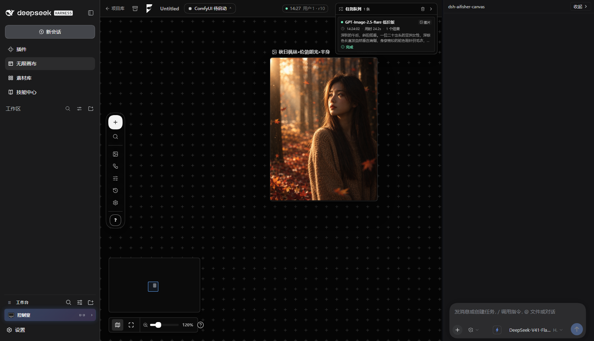
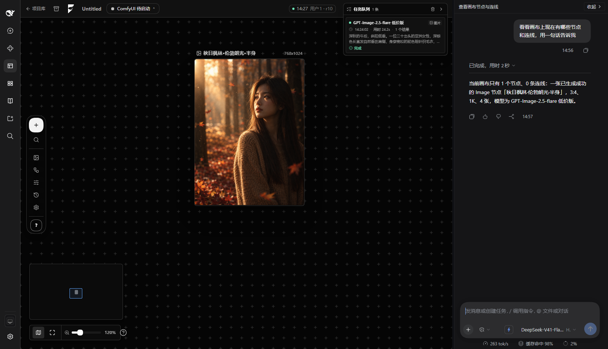
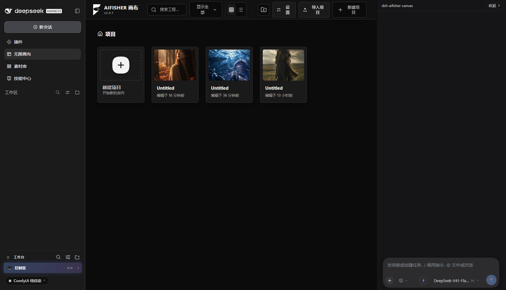
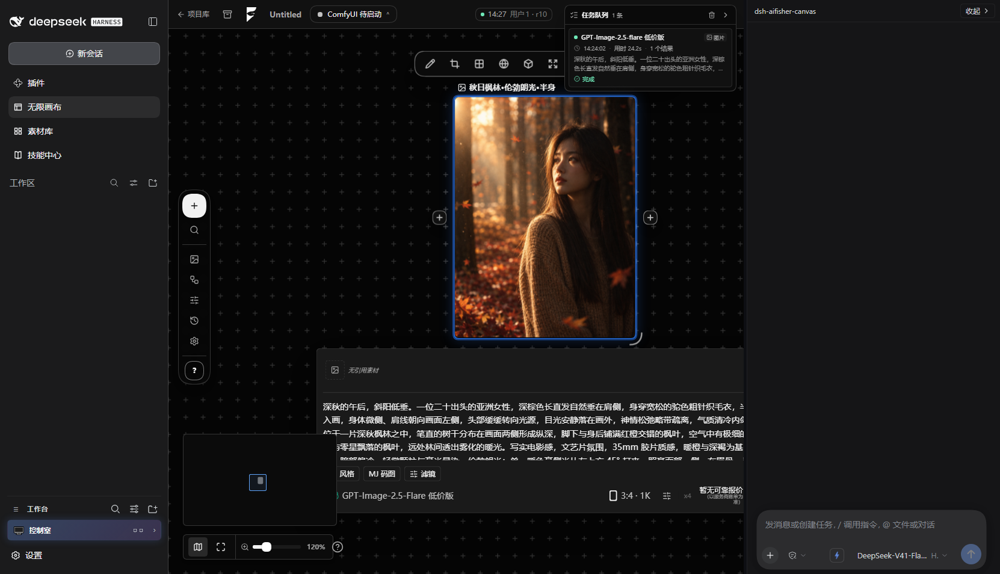

# 🎨 dsh-aifisher-canvas

> 把专业级 AI 创作无限画布带进 DeepSeek Harness：**不是插件内置一个聊天框，而是让 DSH 原生 AI Agent 直接接管整个画布**——本地 ComfyUI、多云端生成、节点编排、素材整理，全靠你在右侧说一句话完成。

**Version**: v1.44 | **Node**: ≥22.19 | **React**: 19 | **TypeScript**: 5.8 | **License**: AIFISHER Noncommercial

---

## 📸 界面



<sub>左边是 DSH，中间是无限画布（节点 + 生成结果 + 任务队列），右边就是那个能动手改画布的 DSH 原生 Agent。</sub>



<sub>右侧对话区随手问一句「画布上现在有什么」，Agent 自己读回节点、连线、类型、坐标和生成参数——它看得到你画布上的一切。</sub>

| 项目库 | 选中节点 · 参数面板 |
|---|---|
|  |  |

<sub>大图见 [`docs/shots/`](docs/shots/)。</sub>

---

## ✨ 核心亮点：DSH Agent 原生接管画布

这不是在插件里套了一个写死提示词的"生图对话框"——你右侧的聊天栏就是完整的 DSH 原生 Agent（模型走 DSH 配置，可接入任意兼容的大模型 API：Base URL + Key）：

- 🎯 **直接操作画布对象**：Agent 能看到画布上所有节点、连线、素材，通过 `canvas_control` 工具直接放节点、连参数、调位置、批量整理素材，不需要你手动拖拽
- 🗣️ **自然语言搭工作流**：你只需要说"帮我在画布中间放一个文生图节点，接上我常用的 SDXL 大模型，提示词写一只在雨夜路灯下的三花猫，生成4张"，Agent 会自动完成节点创建、参数填充、连线，并把生成确认卡片递到你面前——最后那一键（费用授权）始终由你自己按
- 🧩 **完整技能生态打通**：Agent 不只能调用画布内置能力——它能读取你项目级、用户级安装的所有 DSH 技能，查文档、写脚本、处理素材后直接把结果放回画布
- 🛠️ **对话式功能开发**：不只是操作已有节点——你可以直接让它写自定义 ComfyUI 工作流、写素材处理脚本、配置并暴露新的画布节点、调整通道参数，写完即挂到画布上跑，不需要你手写 JSON 或改代码
- 🖼️ **素材自动回流**：Agent 跑脚本处理完图片、下载完素材、生成完结果，会自动放到画布你指定的位置，连参数引用、连线都帮你接好
- 🔍 **上下文全感知**：Agent 知道你当前画布上有什么项目、你上次用的是哪个模型、你之前生成过什么图，不需要反复跟它交代背景

> 传统 AI 画布是"你手动摆节点 + 点按钮生成单张图"，这个插件是"你跟 AI 说你要做什么，AI 自己在无限画布上帮你搭整个创作流水线"。

---

## 🗺️ 其他核心能力

### 本地 ComfyUI 深度集成
- 自动扫描本机 ComfyUI 节点、模型、LoRA 列表，下拉选模型不用手动敲文件名
- 支持导入你自己在 ComfyUI 里 `Export(API)` 的自定义工作流，勾选要暴露的参数后一键变成画布节点
- 提交前自动校验节点和模型是否存在，缺哪个节点/模型直接告诉你本机相近候选是什么
- 节点上模型名和你本机文件名差量化后缀时自动对账，不用手动改

### 多云端生成通道
| 通道 | 支持能力 |
|---|---|
| 火山方舟直连 | 生图/生视频，模型自动同步 |
| OpenAI 兼容接口 | 任意符合 OpenAI schema 的生图端点都能接 |
| 魔搭 ModelScope | 一键预设，支持参考图数组传入 |
| FisherAI | 异步任务轮询，自动上传参考图公网直链 |

- 新建节点自动沿用上一次你选过的模型，不用每次重新下拉
- 多通道多模型并行管理，任务队列里统一看进度、取消、清空

### 无限画布原生体验
- 节点连线、编组、框选复制粘贴、历史回退全套基础能力完整保留
- 多选图片自动折叠成叠图，不展开也能在卡片上翻页查看
- 两步式智能扩图：先自动生成外延参考画面，再生成你自己的扩图节点，提示词参考图自动填好，生成由你自己触发
- 内置图片裁剪、标注蒙版、尺寸调整工具，不用跳出去用其他软件

### 项目迁移与数据自主
- 一键导出 `.fisherai` 项目归档包，换机导入直接恢复整个画布
- 数据目录可以自定义到任意磁盘，C 盘不够用直接搬走，不污染系统盘
- 所有素材、工作流、配置本地存储，不上传到第三方服务器

---

## 🚀 快速开始

### 环境要求
- Node.js ≥ 22.19
- DeepSeek Harness ≥ 0.1.0-rc.7
- 本地生成需自行启动 [ComfyUI](https://github.com/comfyanonymous/ComfyUI)（默认地址 `http://127.0.0.1:8188`）

### 安装
```bash
# 安装依赖
pnpm install

# 构建插件（构建链顺序不可变）
pnpm build
```
重启 DSH 后，侧边栏点击「无限画布」即可开始使用。

### 基础操作速查
| 操作 | 方式 |
|---|---|
| 唤起节点搜索 | `Shift + A` / 双击空白处 |
| 自定义工作流 | 左侧栏导入 ComfyUI 导出的 API JSON |
| 配置云端通道 | 设置 → 闭源服务，填 Base URL + API Key |
| 让 AI 帮你操作画布 | 直接在右侧聊天栏说你的需求即可 |

---

## 🧱 技术实现

```
vendor/aifisher/        # 上游 AIFISHER 源码树，零修改
  ├─ 锚点补丁脚本        # 每条补丁带命中次数断言，上游改写法立刻构建报错
  ├─ 整文件覆盖          # 仅修改需要适配的核心文件
  └─ 装配层              # 多安装器注入画布槽位
```

- 前端：React 19、Tailwind CSS 4、shadcn/ui、TipTap、Wavesurfer
- 后端：Node.js 原生 HTTP 服务，所有接口统一 `/api/aifisher/*` 命名空间
- 双 bundle 架构：host 半进程内加载，client 半浏览器独立运行，跨 bundle 通过全局桥通信
- 测试覆盖：jsdom 契约测试 + 真机浏览器视觉校验，累计 1900+ 回归用例守住画布几何、交互、响应逻辑
- Agent 契约：[docs/canvas-agent-contract.md](docs/canvas-agent-contract.md) —— `canvas_control` 每类 operation 的字段、`configure` 的四条硬约束（模型名逐字匹配 / 换模型会重置高级参数）、生成授权边界与错误码速查。**要让 AI 正确操作画布，先喂它这份文档。**

---

## 📂 数据存储

所有数据默认存放在 `$DSH_HOME/storages/dsh-aifisher-canvas/`，支持在设置中一键迁移到其他磁盘：
- `canvas.json`：画布项目、节点、视口自动存档
- `media/`：生成与上传的图片/视频/音频素材
- `workflows/`：自定义 ComfyUI 工作流配置
- `cloud-channels.json`：云端通道与密钥配置（密钥值不回传前端）

---

## 📄 许可证

⚠️ 本项目基于 AIFISHER 源码构建，采用 **AIFISHER Noncommercial Source License 1.0**：
- ✅ 个人学习、非商业创作、技术研究可自由使用与修改
- ❌ **禁止任何商业用途**：包括接私单、付费出图、售卖插件、商业 SaaS、付费托管
- 再分发必须保持免费，并保留 LICENSE / NOTICE 文件与修改说明
- 商用授权请联系原版权方 Work-Fisher 获取书面许可

---

## 🤝 贡献

欢迎提交 Issue 和 PR。修改代码前请阅读 `README.dev.md` 中的开发约束章节，了解 vendor 补丁机制、双 React bundle 隔离规则和画布几何的 dpr 约束，避免踩历史踩过的坑。
