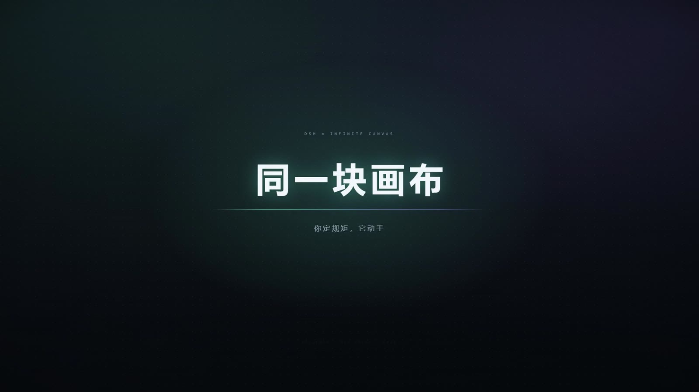
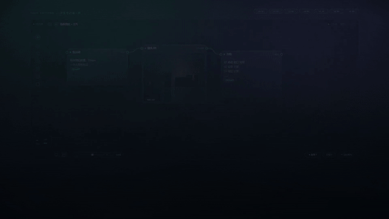
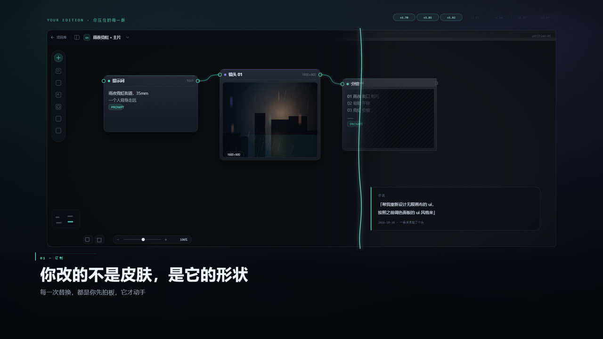
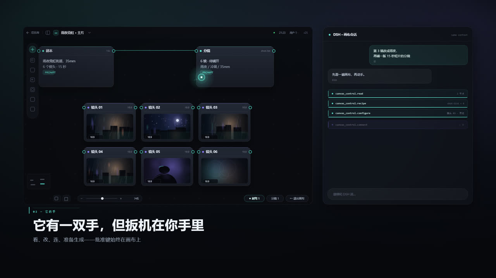
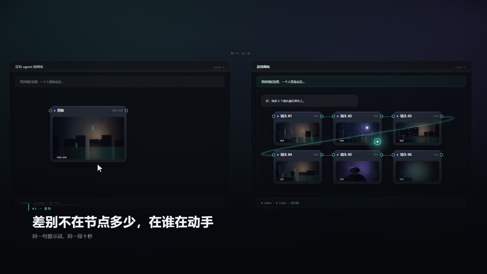
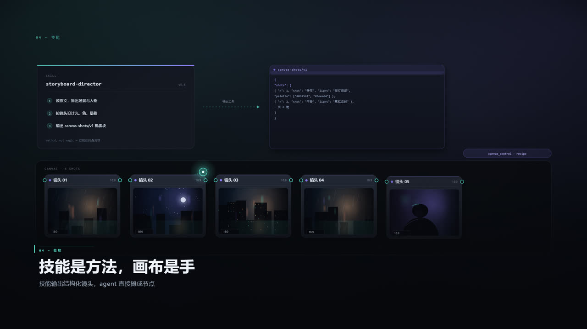
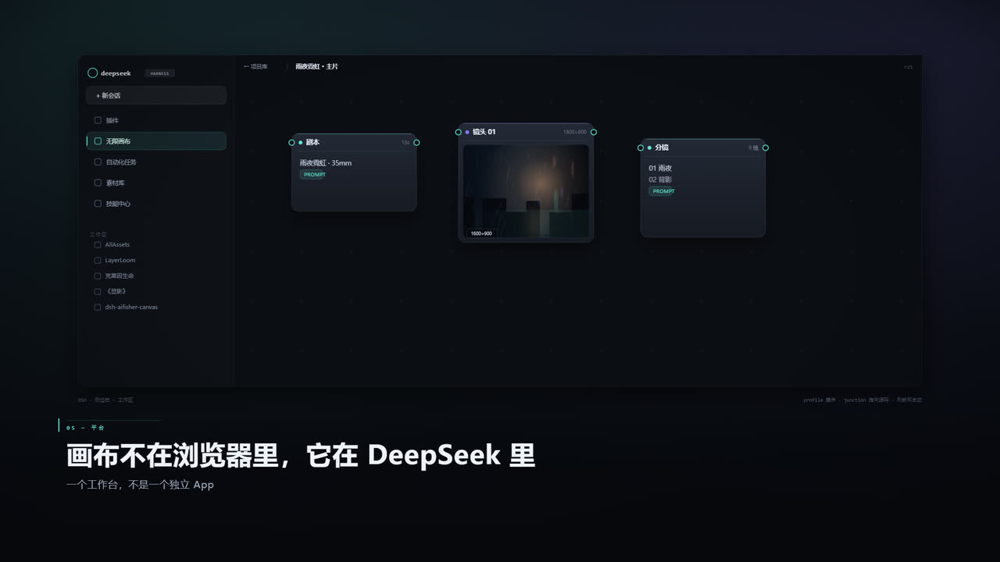
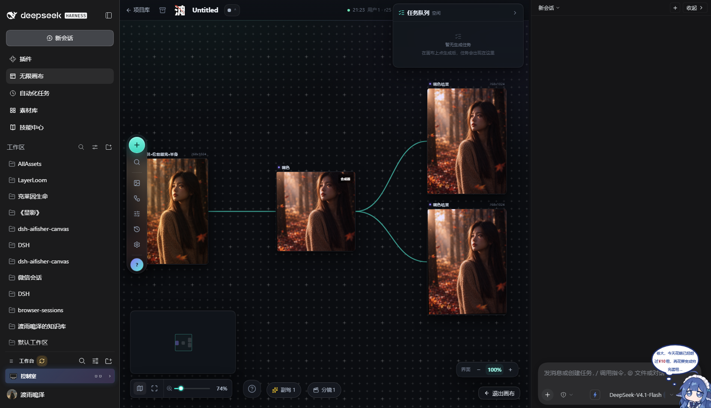
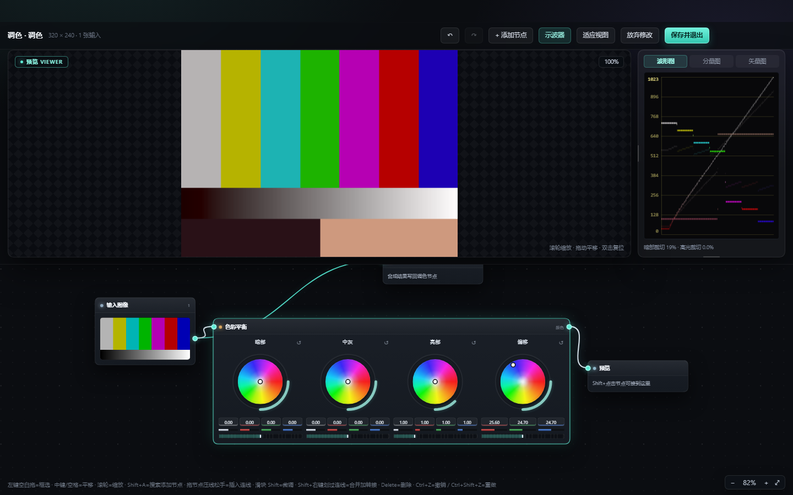
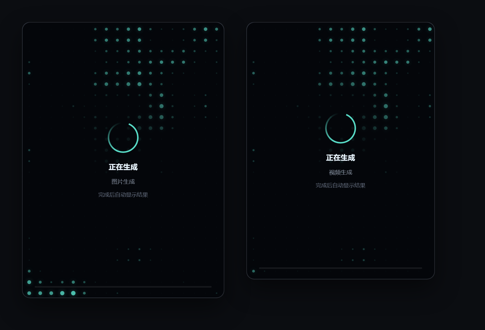

<p align="center"></p>

<h1 align="center">dsh-aifisher-canvas</h1>

<p align="center"><b>把 DeepSeek Harness 变成一间会动手的创作工作室。</b><br>
一块专业级 AI 创作无限画布 —— 你说一句话，DSH 原生 Agent 在画布上替你搭好整条流水线；<br>
而按下「生成」的那一下（费用授权），永远由你自己按。</p>

**Version**: v1.87 | **Node**: ≥22.19 | **React**: 19 | **TypeScript**: 5.8 | **License**: AIFISHER Noncommercial

<p align="center">
  
  
  
  
  
  
</p>

<p align="center"><a href="docs/media/same-canvas-78s.mp4"></a></p>

<p align="center"><b>🎬 <a href="docs/media/same-canvas-78s.mp4">观看 78 秒宣传片</a></b>（1920×1080 · 带音轨 · 13 MB）<br>
<sub>点海报或链接播放。下面的 GIF 是片中第 02 场「它的手」，自动循环。</sub></p>



---

## 一分钟看懂：它和前一种 AI 画布差在哪

| | 没有 agent 的画布 | 这块画布 |
|---|---|---|
| **谁在动手** | 你手动摆节点、点按钮、一张一张生成 | 你说「做一段 15 秒、三段的分镜」，它把剧本、分镜、关键帧、视频节点摊在画布上 |
| **提示词在哪** | 写在对话框里，图和画布是两回事 | 提示词、参考图、结果、调色都是画布上的节点，看得见、连得上、改得动 |
| **跨镜头一致** | 每个镜头重新交代一遍背景 | 项目记忆 + 视觉一致性「锚点」，跨镜头锁脸锁服装 |
| **缺一个功能** | 插件做好什么你用什么 | 技能给方法、画布给手：缺什么让它当场写一个节点挂上去 |
| **花钱的那一下** | —— | 它只准备批次，**确认卡片递到你面前，扳机在你自己手里** |

一句话：**你定规矩，它动手。**

---

## 🎬 宣传片 · 同一块画布（78 秒）

片中只有两个光标：白色箭头是你，青色圆环是它。片头擦身而过，结尾汇成一个 ∞。

| 时间 | 场次 | 画面 |
|---|---|---|
| 0:00 | 片头 | 点阵暗场，「同一块画布」逐字升起，两枚光标擦身 |
| 0:05 | 01 定制 | 一笔青色笔锋扫过，v1.70 的旧皮肤变成玻璃面板；版本胶囊 v1.70 → v1.86 逐个点亮 |
| 0:18 | 02 它的手 | 右侧 DSH 会话里，`read → recipe → configure → connect → preview → progress` 六条工具调用驱动画布，最后停在「6 项生成已准备 · 在画布内批准」 |
| 0:31 | 03 差别 | 同一句提示词、同一段十秒：左边 1 个节点、0 条连线；右边 9 个节点、6 个镜头 |
| 0:41 | 04 技能 | `storyboard-director` 输出结构化的 `canvas-shots/v1`，Agent 一次 `recipe` 摊成 6 个镜头 |
| 0:50 | 05 平台 | 画布是 DSH 侧边栏里的一个工作台，不是独立的 App |
| 1:01 | 06 能力 | 本地 ComfyUI、云端通道、自定义端点逐条「已就绪」；调色合成器、整页扩图、分镜、素材库逐张加进工具条 |
| 1:10 | 收尾 | ∞ 徽标，两条轨迹汇合：「你定规矩，它动手」 |

| 01 · 你改的不是皮肤，是它的形状 | 02 · 它有一双手，但扳机在你手里 |
|---|---|
|  |  |
| **03 · 差别不在节点多少，在谁在动手** | **04 · 技能是方法，画布是手** |
|  |  |

**05 · 画布不在浏览器里，它在 DeepSeek 里**



<sub>宣传片用这套插件自己的视觉语言做的（点阵、玻璃面板、双光标），源工程与出片脚本在片尾署名；成片 78 秒、无摄像机运动，只靠元素的进场与生长。</sub>

---

## 📸 界面



<sub>v1.81 起的「玻璃面板」皮肤：冷灰蓝底、半透明面板、青色连线；右下角是界面缩放（80–150%）与「退出画布」，左下角是小地图，底部是副驾 / 分镜。</sub>

| 调色合成器：四轮调色 + 达芬奇同款示波器 | 生成中：噪波点阵 + 不定进度环 |
|---|---|
|  |  |

<sub>更多取证图见 [`docs/shots/`](docs/shots/)。</sub>

---

## ✨ 核心亮点：DSH Agent 原生接管画布

这不是在插件里套了一个写死提示词的"生图对话框"——你右侧的聊天栏就是完整的 DSH 原生 Agent（模型走 DSH 配置，可接入任意兼容的大模型 API：Base URL + Key）：

- 🎯 **直接操作画布对象**：Agent 能看到画布上所有节点、连线、素材，通过 `canvas_control` 工具直接放节点、连参数、调位置、批量整理素材，不需要你手动拖拽
- 🗣️ **自然语言搭工作流**：你只需要说"帮我在画布中间放一个文生图节点，接上我常用的 SDXL 大模型，提示词写一只在雨夜路灯下的三花猫，生成4张"，Agent 会自动完成节点创建、参数填充、连线，并把生成确认卡片递到你面前——最后那一键（费用授权）始终由你自己按
- 🧩 **完整技能生态打通**：Agent 不只能调用画布内置能力——它能读取你项目级、用户级安装的所有 DSH 技能，查文档、写脚本、处理素材后直接把结果放回画布
- 🛠️ **对话式功能开发**：不只是操作已有节点——你可以直接让它写自定义 ComfyUI 工作流、写素材处理脚本、配置并暴露新的画布节点、调整通道参数，写完即挂到画布上跑，不需要你手写 JSON 或改代码
- 🖼️ **素材自动回流**：Agent 跑脚本处理完图片、下载完素材、生成完结果，会自动放到画布你指定的位置，连参数引用、连线都帮你接好
- 🔍 **上下文全感知**：Agent 知道你当前画布上有什么项目、你上次用的是哪个模型、你之前生成过什么图，不需要反复跟它交代背景
- 📎 **@ 画布节点当上下文**：在输入框敲 `@` 直接选画布上的文本 / 图像 / 视频 / 音频节点，发送时自动把该节点的只读快照（标题、正文、结果地址）带在消息后面——指着某个节点说「把这张图改成…」就行，不用先让 Agent 自己 read 一轮
- 🔔 **生成事件推回面板**：Agent 准备的批次跑完后，宿主会把结果（成功/失败、错误码、节点 id）**推回这条对话**——Agent 接着就能看图自评、修失败、重新准备，你不用再问一句「生成完了吗」；费用确认仍然只在画布上按
- 🧠 **项目记忆**：画风、角色设定、常用模型/参数记进项目记忆后，新开一个对话会自动带上（同一份内容只注入一次），不用每次重新交代
- 🎭 **视觉一致性**：把角色定妆 / 画风参考节点设为「锚点」，一次 `lock` 就接到所有镜头上（锚点即上游参考图），跨镜头锁脸锁服装；副驾会提示还剩几个镜头没锁
- 🎬 **长任务编排**：一句话提交「做完这组镜头」——host 端按既定流水线建节点、锁参考、准备批次，然后等你在确认卡上按一次；某个镜头失败会**自动再准备一批重试**（仍然要你确认，不自动花钱）
- 🗂️ **分镜板**：画布底部一条缩略图带，按镜头号排好、点一张聚焦过去、按播放自动翻页——只看顺序，不塞完整导演台
- 🧭 **主动副驾**：发现失败节点、空提示词、没锁的镜头时，在左下角安静冒一个小胶囊，点开才看建议；没有建议时不出现，点「不再提示」彻底关掉
- 🔁 **在画布里换会话，不被打断**：右侧栏标题本身就是会话列表（可搜、标出当前、滤掉归档与子代理会话），点一条即切；头部「＋」在当前工作区新建（或复用空白）会话。两个动作都在画布内完成——不会再被 DSH 侧边栏那条「先切回对话区」的导航把你带出画布

> 传统 AI 画布是"你手动摆节点 + 点按钮生成单张图"，这个插件是"你跟 AI 说你要做什么，AI 自己在无限画布上帮你搭整个创作流水线"。

---

## 🗺️ 其他核心能力

### 本地 ComfyUI 深度集成
- 自动扫描本机 ComfyUI 节点、模型、LoRA 列表，下拉选模型不用手动敲文件名
- 支持导入你自己在 ComfyUI 里 `Export(API)` 的自定义工作流，勾选要暴露的参数后一键变成画布节点
- 导入后在「ComfyUI 工作流配置」里看**可视化节点图**：逐节点挑模型 / LoRA / 参数，改完写回工作流
- 提交前自动校验节点和模型是否存在，缺哪个节点/模型直接告诉你本机相近候选是什么
- 节点上模型名和你本机文件名差量化后缀时自动对账，不用手动改

### 多云端生成通道
| 通道 | 支持能力 |
|---|---|
| 火山方舟直连 | 生图/生视频，模型自动同步 |
| OpenAI 兼容接口 | 任意符合 OpenAI schema 的生图端点都能接 |
| 魔搭 ModelScope | 一键预设，支持参考图数组传入 |
| FisherAI | 异步任务轮询，自动上传参考图公网直链 |

- 新建节点自动沿用上一次你选过的模型，不用每次重新下拉
- 视频节点的参考图按模式给：**多图参考最多 9 张参考图**（与 MiniMax H3 参考模式同口径），首帧 1 张、首尾帧 2 张
- 多通道多模型并行管理，任务队列里统一看进度、取消、清空
- **生成历史不覆盖**：同一个图片 / 视频节点重复生成时，旧结果留在头部的「历史 N」里，点开可预览、下载、设为主图 / 主视频（图片留 20 条、视频留 12 条）

### 调色合成器（画布里的整套调色台）
- 主画布 `Color Grade` 节点双击进入全屏合成器：上方一块预览，下方一张节点画布（输入 / 输出 / 预览 + 15 种效果）
- 求值在浏览器端（WebGL2、linear 空间、RGBA16F 中间纹理、按节点缓存），拖滑块只重算下游
- **Blender Color Balance 同款四轮调色**（暗部 / 中灰 / 亮部 / 偏移），参数就是界面上的数字（ASC CDL：`slope = gain − lift`、`offset = lift`）
- **达芬奇同款示波器**：波形图 / 分量图 / 矢量图，10-bit 0–1023 刻度、75% 彩条靶位按 BT.601 反算
- 手势按主画布对齐：左键框选、中键平移、双击断线、`Ctrl+右键` 划线断开、`Shift+右键` 同源线收进转接点、拖节点压线即串进链路、`Ctrl+Z / Ctrl+Shift+Z` 撤销重做
- 「保存并退出」把结果落成节点右侧的一张「调色结果」图，下游生成节点直接拿来当参考

### 无限画布原生体验
- 节点连线、编组、框选复制粘贴、历史回退全套基础能力完整保留
- **Blender 式切刀**：按住 `Ctrl` + 鼠标右键拖拽，划过的连线当场变红、松手即断开（`Esc` 取消，只断划过的那条）
- **划选合并 / 转接口**：按住 `Shift` + 鼠标右键拖拽，划过的连线当场变绿；同一个上游分出去的几条线会并成一条主干，并在划过处插入一个 **34×34 的「转接」小圆点**（圆里直接显示上游缩略图；一路进、多路出，只整理走向、不改参考图，下游照旧拿到上游那张图）。不同上游各得一个转接点。`Esc` 取消
- 多选图片自动折叠成叠图，不展开也能在卡片上翻页查看
- 两步式智能扩图：整页工作台先按目标比例画出「扩图画面」（原图落位、待补区斜纹标注），再生成你自己的扩图节点，提示词参考图自动填好，生成由你自己触发
- 内置图片裁剪、宫格切分、标注蒙版、尺寸调整工具，不用跳出去用其他软件
- **文本节点直接吃 Markdown**：把 `.md` / `.txt` 从系统里拖到画布上，指针处就落一个排好版的文本节点（标题 / 嵌套清单 / 表格 / 代码块 / 加粗），节点里的「导入文本」也按 Markdown 解析；正文给模型读的是**去掉记号的干净纯文本**，屏幕上看到的是排版（见 [docs/markdown-text-nodes.md](docs/markdown-text-nodes.md)）
- **换肤与界面缩放**：玻璃面板皮肤（与调色合成器同一套视觉语言）、80 / 90 / 100 / 110 / 125 / 150% 六档缩放、生成中的噪波点阵——都不改画布内容本身

### 项目库与设置页
- 打开「无限画布」直接进**项目库**：全部 / 最近编辑 / 收藏 / 已归档，图片·视频·文本筛选，真实本地占用，卡片墙与「5 列清单 + 右侧详情」两种视图
- 打开项目走 `fisherai:open-project`，不刷新页面；**点一次就进画布**（v1.86 修掉的「要点两次」）
- **设置页**：外观与主题 / 生成 / 服务与通道 / 项目与数据 / 高级与关于；界面缩放、光标辉光、画布背景图、本地 ComfyUI、新建节点默认模型、数据目录、导出目录、自动保存都真接上
- 没做完的选项**置灰并标「设计稿」**——页面不撒谎

### 项目迁移与数据自主
- 一键导出 `.fisherai` 项目归档包，换机导入直接恢复整个画布
- **项目数据目录**可以自定义到任意磁盘，C 盘不够用直接搬走，不污染系统盘
- 所有素材、工作流、配置本地存储，不上传到第三方服务器

---

## 🚀 安装

### 0. 环境要求
- **Node.js** ≥ 22.19 + **pnpm**
- **DeepSeek Harness** ≥ 0.1.0-rc.7（桌面版 / Web 版都行）
- 要跑**本地生成**才需要 [ComfyUI](https://github.com/comfyanonymous/ComfyUI)（默认地址 `http://127.0.0.1:8188`）；只用云端通道不需要

### 1. 准备上游 AIFISHER 源码
构建链的第一步 `pnpm vendor` 每次都会从一份**完整的上游 AIFISHER 源码树**重新复制到 `vendor/aifisher/`，再逐条打补丁（每条补丁都带「命中 N 次」断言）——仓库里 `vendor/aifisher/` 现存的内容是上一次构建的产物，**不是这一步的输入**。上游源码按其原版权方的许可证分发，请自行获取（版权方 Work-Fisher）。

默认按候选顺序自动探测，最省事是把它放在与本仓库同级的 `AIFISHER-main/`；也可以显式指定：

```powershell
# PowerShell
$env:AIFISHER_SRC = 'D:\path\to\AIFISHER-main'
```

```bash
# bash
export AIFISHER_SRC=/path/to/AIFISHER-main
```

> 报 `[vendor] 找不到 AIFISHER 源码` 就是这一步目录没找对。

### 2. 构建
```bash
git clone <本仓库> dsh-aifisher-canvas
cd dsh-aifisher-canvas
pnpm install
pnpm build
```

`pnpm build` = `clean → vendor-aifisher → build-canvas-css → tsdown`，**顺序不可变**。产物三件，DSH 加载的就是它们：

- `lib/index.js` — host 半（路由、ComfyUI、生成、媒体库、诊断）
- `lib/client/apply.js` — 浏览器半（panel / slot 注册）
- `lib/canvas/canvas-app.js` — 画布应用本体

> 没有上游源码树、只想编译现有 `vendor/`：用 `pnpm build:offline`（CI 走的就是这条）。

### 3. 装进 DSH
1. 打开 DSH → **设置 → 插件 →「添加插件」**。
2. 填**插件目录的绝对路径**（就是第 2 步构建出 `lib/` 的那个目录），点安装。
   DSH 会把这个目录 link 进当前 profile，并把 `dsh-aifisher-canvas` 追加进 profile 的 `dsh.profile.bundles`，默认启用。
3. **重启 DSH**。host 半是进程内加载的，只刷新页面不会更新它。

不想用界面时，手工等价做法是改 `$DSH_HOME/profiles/<profile>/package.json`，然后在 profile 目录跑 `pnpm install`、重启 DSH：

```jsonc
{
  "dependencies": { "dsh-aifisher-canvas": "link:D:/path/to/dsh-aifisher-canvas" },
  "dsh": { "profile": { "bundles": [ /* …原有组合包… */, "dsh-aifisher-canvas" ] } }
}
```

### 4. 验证
侧边栏出现 **「无限画布」** → 打开 → 项目库 → 新建项目。要用本地生成的话，画布左上角 ComfyUI 胶囊应变绿；云端通道在 **设置 → 服务与通道** 里配。具体上手见 [`使用说明.md`](使用说明.md)。

### 5. 更新与卸载
- **更新**：改完源码重新 `pnpm build` → 重启 DSH。DSH 不自动更新插件，换版本要在插件页重装。
- **卸载**：设置 → 插件里移除（DSH 会先把组合包摘出 `dsh.profile.bundles`，再执行 `pnpm remove`）。画布数据留在 `$DSH_HOME/storages/dsh-aifisher-canvas/`，不会被删。

### 安装常见报错
| 现象 | 原因 / 处理 |
|---|---|
| `[vendor] 找不到 AIFISHER 源码` | 上游源码没准备或路径不对 → 见第 1 步 |
| 构建报「找不到模块 tsdown / jsdom」 | 盘符变过，`node_modules` 里 junction 存的是绝对路径已悬空 → `node scripts/fix-node-modules-junctions.mjs --dry` 先看计数，去掉 `--dry` 真改 |
| 装完侧边栏没有「无限画布」 | 组合包没启用，或没重启 DSH → 设置 → 插件 里确认 `dsh-aifisher-canvas` 已开启，再重启 |
| 画布能打开但接口 404 | host 半没重新加载（只刷新页面不够）→ 重启 DSH |

### 基础操作速查
| 操作 | 方式 |
|---|---|
| 唤起节点搜索 | `Shift + A` / 双击空白处 |
| 自定义工作流 | 左侧栏导入 ComfyUI 导出的 API JSON |
| 配置云端通道 | 设置 → 服务与通道，填 Base URL + API Key |
| 切刀 / 合线 | `Ctrl + 右键` 划断 / `Shift + 右键` 划合 |
| 让 AI 帮你操作画布 | 直接在右侧聊天栏说你的需求即可 |

---

## 🧱 技术实现

```
vendor/aifisher/        # 上游 AIFISHER 源码树，零修改
  ├─ 锚点补丁脚本        # 每条补丁带命中次数断言，上游改写法立刻构建报错
  ├─ 整文件覆盖          # 仅修改需要适配的核心文件
  └─ 装配层              # 多安装器注入画布槽位
```

| 层 | 内容 |
|---|---|
| 前端 | React 19、Tailwind CSS 4、shadcn/ui、TipTap、Wavesurfer |
| 后端 | Node.js 原生 HTTP 服务，所有接口统一 `/api/aifisher/*` 命名空间 |
| 架构 | 双 bundle：host 半进程内加载，client 半浏览器独立运行，跨 bundle 通过全局桥通信 |
| 与 DSH 的边界 | 画布会把「从系统拖进来的文件」事件止步在自己的容器上（`containFileDrags`）。宿主把「拖入即可添加附件」的全屏提示层挂在 `document` 的 dragenter/dragleave 计数上，而画布的 `onDrop` 会 `stopPropagation` —— 不拦住的话宿主永远收不到那次 drop，计数停在 1，整屏遮罩再也退不掉（真机踩过）。同理，任何一次鼠标点击都会补一次 dragleave，把已经卡住的遮罩解开 |
| Agent 契约 | [docs/canvas-agent-contract.md](docs/canvas-agent-contract.md) —— `canvas_control` 每类 operation 的字段、`configure` 的硬约束、生成授权边界与错误码速查。**要让 AI 正确操作画布，先喂它这份文档** |
| 测试 | 类型门禁（`pnpm typecheck`）+ 55 套 jsdom 契约测试（3000+ 项）+ 真机浏览器视觉校验（`browser-check` / `verify-live-*`） |

<details>
<summary><b>实现细节与版本日志（v1.58 – v1.87）</b> —— 每个版本改了什么、踩了什么坑</summary>

### 数据与保存

- 保存链路（v1.58，见 `scripts/patches/aifisher/src/stable/persistence/canvasWorkflow.ts`）：上游的乐观并发是「撞 409 → 重读服务端 → 三向合并 → 重发」，但三向合并遇到**同一字段两边都改**会抛冲突，并把这份文档的保存**永久封锁**（只有重新打开项目才解），画布照常能编辑、实际一个字都存不进去。本插件改成「救援合并」：节点/分组按 id 取并集、同 id 以当前窗口为准、**一定落盘**，并提示用户核对；保存/读取请求另加 20s 超时，避免一次挂住的请求把保存队列永久占死。agent 的每次改动还会由 host 立刻追加一次保存，回执里用 `saved` 说明有没有真的写进 `canvas.json`。
- 云端结果落盘（2026-10-20）：云端通道回的是**服务商临时链接**（如 `https://file*.aitohumanize.com/file/<hash>.png`），host 侧会先把字节下载进素材库，节点的 `resultUrl` 才是同源 `/api/aifisher/canvas/media/...`。图床在任务刚回报 SUCCESS 的头几秒常常还是 404（文件没落地），所以下载带 4 次退避重试；真要失败，节点会显示「图片链接已失效」并留痕到 `/api/aifisher/canvas/diagnostics`（`installImageLoadTelemetry` 收 img 的 error 事件），而不是静默留一块黑。
- 火山方舟直连（v1.60）：一张卡片管两种媒体，只认 `ARK_API_KEY`。**图片**走 `POST /api/v3/images/generations`（`arkImageProvider.ts`：档位+比例 → `size`、参考图内联成 data URL、组图/图层拆分按模型能力分流）；**视频**（Seedance 2.0，`arkVideoProvider.ts`）走异步任务 —— `POST /api/v3/contents/generations/tasks` 提交 `content` 数组（`text` / `first_frame` / `last_frame` / `reference_image` / `reference_video` / `reference_audio`）再轮询 `GET …/tasks/{id}`，出片后立刻把 mp4 下载进素材库。参考图的字节内联（方舟访问不到 `127.0.0.1`），参考视频/音频只收公网直链；模型名逐字取自画布目录（`豆包视频2.0`），界面的「自定义模型 ID」可换成账号下的推理接入点（`ep-…`）。

### 视频节点（v1.64 – v1.68）

- 生成历史（v1.64）：图片节点本来就有的「历史 N」现在视频节点也有 —— 合并/换位/文案的纯函数在 `src/canvas-ui/canvas/CanvasVideoHistory.ts`（去重、视频上限 12 条），经装配层挂成 `__FISHERAI_VIDEO_RESULT_HISTORY__` 桥；`canvasGeneration.ts`（生成成功）、`generationRecovery.ts`（断线/刷新回收）两处都走它，播放器（整文件覆盖 `canvasVideoPlayer.tsx`）负责头部药丸、扇形历史叠与「设为主视频」。换主视频会清掉 `lastFrame` 与旧比例，首尾帧/比例按新片重算；历史是节点数据，随 `.fisherai` 一起导出。
- 视频截帧（v1.66）：视频底栏那枚按钮变成三项菜单 —— **截取首帧 / 截取尾帧 / 首尾帧各一张**，单截一帧不会多掉一个要删的节点。取帧在 `src/canvas-ui/canvas/CanvasVideoFrames.ts`（输出最长边 2048、尾帧从 `duration - 0.05` 起试、探到空白画面自动往前退），落位在 `CanvasFrameLayout.ts`（贴视频右侧 60px、首上尾下、避开已有节点，截完把「视频 + 新帧」一起聚焦进视口），vendor 侧只做接线（补丁 3.8x）；截帧节点的提示词留空，不会被当成生成提示词。
- 截帧加固（v1.67，2026-10-23 报障「截取视频首尾帧失败了」）：等待判定从「单次 `seeked` 快照」改成**事件唤醒 + 40ms 轮询**（事件来早了、干脆不来都不会再白等 15s 报「视频定位超时」）；落点容差 0.5s（Chromium 会吸到最近可解码帧）；按 `seekable` 钳制目标（远端素材只缓冲了一截时不硬拖片尾）；空白帧先等最多 800ms 再判；超时**换一个新解码器重试一次**；错误文案带现场（`readyState` / 是否仍在寻址 / 落点 / 时长）。同时 host 的 `/api/aifisher/canvas/proxy` **开始透传 Range**（206 + `Content-Range`）——以前远端视频经代理后浏览器当它是「不可寻址」，拖进度条和截尾帧都会卡死。
- 进度条拖拽（v1.68，2026-10-23 报障「视频下方进度条拖到不了」）：底栏那根 16px 的原生滑杆换成**自己吃指针的轨道** —— 整条轨道（20px + 上下余量）按下即跳到落点，不再要求戳中 12px 的拇指；拖动期间读数/拇指 1:1 跟指针（本地 scrub 状态，播放时钟的回写不会再把拇指拽回去）；seek 按 120ms 节流、松手补最后一下（长片里 60Hz 连打会打乱解码器）；松手后真在寻址时显示「定位中…」；底栏收起时 `pointer-events-none`，不再吞掉视频底部的点击。实现在整文件覆盖 `canvasVideoPlayer.tsx`，回归 `test:video-seek`（19 项）。

### 调色节点 / 合成器（v1.70 – v1.80）

- 调色节点 / 合成器（v1.70）：主画布新增 `Color Grade` 节点（右键「调色」创建，多图输入上限 10）。节点卡上的「合成器」按钮（或双击）进入全屏合成器：上方**一块预览**，优先显示「预览」节点（没接线时退回输出，标签会写明是哪个）；下方是节点画布，预置 **输入 / 输出 / 预览** 三个节点 —— 输入节点的输出口数量等于上游图片数（接 3 张就是 3 个口），默认就连好「输入→输出 / 输入→预览」两条线（黄绿＝图像、灰白＝蒙版，端口接上后填充）。连线画在屏幕坐标里，滚轮缩放时线宽不变粗。画布手势与主画布一致：**左键拖＝框选**（可多选、拖动任一选中节点整体移动、`Delete` 批量删）、**中键 / 空格+左键＝平移**、滚轮以光标为中心缩放、点阵背景跟随平移/缩放，首次打开自动适应视图。`Shift+点击节点`接到预览、`Ctrl+Shift+点击`接到输出、`Shift+A` 或「+ 添加节点」按分类加效果。15 种效果：色彩平衡、曲线、色相/饱和度、亮度/对比度、曝光、Gamma、混合（14 种模式，W3C 公式）、Alpha 上叠、模糊、锐化、暗角、颗粒、变换、椭圆/矩形/渐变蒙版。点「应用」把输出落进媒体库并写回节点的 `resultUrl`，下游生成节点可直接当参考图；图结构、参数与视图状态存在节点字段 `compositorGraph`，随项目保存。实现在 `src/client/canvas/compositor/`（图纯逻辑 / WebGL 引擎 / 纯 DOM 编辑器三层），vendor 侧 11 处锚点补丁 + 组件追加；回归 `test:compositor`。2026-10-29 按 Blender 手感再收紧：**参数控件直接长在节点体内**（右侧属性面板拆掉，卡片宽 224px）；**上方预览可缩放平移**（滚轮以光标为中心 20%–800%、双击复位 100%，只改 transform 不重算求值）；**`Shift+A` / 「+ 添加节点」建出来的节点跟着鼠标走、左键放下**；调色面板开着时画布的切刀/合线手势**让路**。
- 调色面板 v1.73（2026-10-29）：**拖节点压住连线松手就串进去**（Blender 的 insert-on-link，压住的线会变蓝加粗）；**端口命中区 10px → 26px**，松手还按「线上的输入口 → 节点身上取空输入口 → 34px 内最近输入口」三级吸附；数字参数换成**专业单位 + 全宽滑轨**（色相 ±180°、饱和度/明度/强度 ±100%、色温 2000–12000K、曝光 EV；Shift/Alt 拖动 0.12× 微调、双击复位、数字框直填）；**曲线节点**支持主曲线 + R/G/B 分通道（点击加点 / 拖动 / 双击删点，引擎合成 256×1 LUT 查表，单调三次插值）；预览右侧常驻**示波器**，并新增**白平衡**节点；点「应用」退出后会在调色节点右侧**自动多一张「调色结果」图**并连成「调色 → 结果图」。顺手修掉 **WebGL2 下导出全黑**（RGBA16F 直接 `readPixels(UNSIGNED_BYTE)` 是非法组合，现在统一先画进 RGBA8 再读）。
- 示波器换成达芬奇同款 v1.74（2026-10-29）：**波形图 / 分量图 / 矢量图**三张（直方图 tab 撤掉），纵轴统一 **10-bit 0–1023**、每 128 一格、顶格写 1023。**分量图**红/绿/蓝三路并排、共用刻度与同一峰值；**波形图**用每格像素的平均色给波形上色；**矢量图**带 5°/30° 刻度环、六个 **75% 彩条靶位**（角度/半径由 BT.601 反算）与肤色线（I 轴 ≈128°）。**面板可调大小**：拖左边缘改宽、拖下边缘改高、双击复位，尺寸存进 `compositorGraph.scope`。
- 四轮调色 v1.75（2026-10-29）：**「色彩平衡」换成 Blender Color Balance 同款四轮卡片** —— 暗部 / 中灰 / 亮部 / 偏移 四个色轮横排，卡片 744px 宽。每个轮子：色相环 + 十字准星 + 白点 + 外圈亮度弧 + 「亮度 + R/G/B」四个数字框 + 四条彩色细滑轨 + 一条带刻度的亮度长条。盘内拖动＝色度（平均亮度不动）、外圈上下拖＝亮度、数字框直接输入、`↺` 复位。**参数就是界面上的数字**：暗部/中灰中性 0.00、亮部 1.00、偏移 25.00；引擎在 linear 空间按 ASC CDL 求值，老项目存的 `liftR…gainB` 不用迁移。
- 调色面板换皮 + 修「放大就糊」v1.76（2026-10-29）：用户反馈「画布上的节点 ui 放大后很模糊」。糊的真因是两处渲染：`.cg-world` 常驻 `will-change: transform` 把整棵节点树固化成合成层位图、缩放时按旧分辨率拉伸；色轮是 canvas，按固定 dpr 画完跟着 `scale()` 一起放大。现在只在缩放/拖动期间加 `.cg-scaling`、抬手 140ms 撤掉；色轮盘面改成 conic + radial 渐变（矢量）；顺手修掉高分屏上**示波器只画左上 1/4** 的老 bug。
- 保存与退出 v1.77（2026-10-29）：用户报「没有应用按钮啊？希望按退出也会输出保存图像」。**按钮被系统窗口按钮压住了** —— DSH 桌面窗口的 `titleBarOverlay` 原生 − ▢ ✕ 画在网页上方、任何 z-index 都盖不住。现在顶栏按 Window Controls Overlay 几何让出系统按钮宽度；主动作改名「保存并退出」，**有改动时按 Esc 也等于保存并落成品图**；导出目标改成「所见即所得」（效果只接了预览链、输出还接着原图时按预览结果导出）。
- 撤销/重做 v1.78（2026-10-29）：用户「添加 ctrl+z 撤销功能」。调色面板按**整张图快照**记历史，**Ctrl+Z 撤销 / Ctrl+Shift+Z（或 Ctrl+Y）重做**；连续手势停手 420ms 合成**一步**，拖一次色相不会吃掉几十步撤销；历史最多 80 步。
- 六条 v1.79（2026-10-30）：顶栏点不动（整排压在系统标题栏带里）、色轮变方（nova 主题的全局 `corner-shape: superellipse(1.5)`，圆形控件统一补 `corner-shape: round`）、下拉纯白（原生 `<select>` 换深色自绘）、混合节点三输入（A / B / 系数）、`Shift+A` 模糊搜索（中文子序列 / 拼音首字母 / 英文名）、自动避让（串进连线后站到上游右边 40px、把挡路卡片向右级联推开，用户亲手放下的那张永不移动）。
- 手势收紧 v1.80（2026-10-30）：用户「画布里的调色面板左键单点就断开连线了，可以双击断开或者 ctrl+鼠标右键划线断开；添加节点的时候节点位置不会以鼠标为中心点」。① **单击不再断开连线**，改 **双击断开** 或 **`Ctrl`（macOS `Meta`）+ 右键划过**（划过的线变红、松手才断、`Esc` 取消）；② **添加节点以指针为中心**：主画布三个入口与调色面板都按节点尺寸反推左上角，**卡片中心落在指针上**。

### 画布换肤 / 页面层 / 首页（v1.81 – v1.86）

- 换肤 + 界面缩放 + 生成中噪波 v1.81（2026-10-30）：用户「重新设计无限画布的 ui，按调色面板的风格、位置尽量不要变」，看设计稿后拍板「按设计好的无限画布 ui 替换」。① **皮肤（方案 C 玻璃面板）**：冷灰蓝底 `#0b0d11` / 半透明玻璃层 / 青色 `#5eead4` 强调 + 紫色 `#8b7cf6` 辅助；顶栏玻璃条 + 青→紫渐变细线，左工具条 48 宽胶囊 + 34 圆钮，缩放条 44 高玻璃卡，小地图玻璃卡，任务队列玻璃面板，节点卡 14 圆角 + 玻璃渐变 + 内高光、标题行「分类色小圆点 + 名称」，端口 12px 青圆点、连线青色 halo、选中态青描边。**vendor 源码一个字没改**（全部覆盖在 `src/client/canvas/skin.ts`）。② **界面缩放**：右下角「界面 − 100% +」胶囊，档位 80/90/100/110/125/150%，`Ctrl + = / − / 0`，`localStorage['af.uiScale']` 持久化；只给 6 类 chrome 加 `zoom`，画布内容不动。③ **生成中**：黑底 + 20px 圆点，value noise 决定每个圆的半径/亮度（团块像 Blender 噪波纹理提对比度，随时间漂移），中央 56px 不定进度环 + 文案、底部不定进度线，**没有真实进度就不假装 62%**。
- 页面层：项目库 + 设置 v1.84（2026-10-31）：用户要「设置页、图像编辑页、扩图页……还有项目管理页」。项目库与设置都是**画布容器的兄弟图层**（portal 到 `.af-canvas-mount`，实测 1182×804 = 容器 100%），画布在下面继续活着。**项目库**：左栏视图（全部/最近编辑/收藏/已归档 + 图片·视频·文本筛选 + 真实本地占用）+ hero「继续编辑」+ 卡片墙（与清单两视图），打开项目走 `fisherai:open-project` 不刷新页面；host 新增 `/api/aifisher/canvas/projects*`（列表/详情/新建/归档/收藏/备注/复制/删除，节点类型与画布包围盒、素材字节、封面图、模型名、进行中任务数全是真读数）。**设置**：左导航 + 四段表单，界面缩放 / 光标辉光 / 画布背景图 / 本地 ComfyUI / 新建节点默认模型 / 数据目录 / 导出目录 / 自动保存都真接上；没做的选项**置灰 + 标「设计稿」**。踩坑：外壳带 hooks 而页面未打开时 `return null` → React #310 把整块画布打崩（改用稳定组件 `CanvasPageShellView`）；按视口贴边的缩放条/小地图/任务队列会从页面下缘戳出来（页面开着时 `html.afg-page-open` 统一藏掉）。说明见 [docs/page-layer.md](docs/page-layer.md)。
- 打开画布 = 新项目库 + 旧版设置移除 v1.85（2026-10-31）：① **首屏换了**：打开「无限画布」直接进项目库，vendor 那张旧看板留在底下当「没有项目」的占位、被 `html.afg-page-open` 藏起来；带恢复标记的刷新仍回到上次的画布；项目库是首屏时不给关。② **旧设置对话框整块移除**：老对话框里的面板改成页内宿主 —— 开源服务（ComfyUI 整页）、闭源服务、自定义通道、项目数据目录、下载目录、检查更新，设置页新增第三个分区「服务与通道」。③ **窄画布 hero 修版**：会话栏展开时画布 ~950px，hero 固定 344+300 会把中间挤成叠字，改用容器查询两列 / 单列。
- 打开画布后点一次就进项目 v1.86（2026-10-31）：用户「打开无限画布后要点击两次才能进入画布，第一次点击好像才正式激活项目管理器」。根因是**项目库关得太早**：点「打开画布」只派发 `fisherai:open-project`，vendor 还要走一次 `loadProject` 才把 view 切成 canvas；这中间项目库先 `closeCanvasPage()`，首屏看门看到「底下还是旧看板 + 页面层一屏都没开」就判定「用户回到了项目库」，立刻把项目库**重新挂一份**，第二次点才进得去。现在**项目库等画布底盘 `#canvas-background` 出现再关**（60ms 轮询 / 6s 超时，等不到就留着页面并提示），首屏看门另按 `fisherai:open-project` 加 5s 窗口不自动开项目库。新增 `scripts/test-canvas-home.mjs`（12 项，jsdom 必须给 `/workflows/<id>` 加 200ms 延迟才复现）与 `scripts/verify-live-home-click.mjs`（CDP 真鼠标，10 项）。

### 文本节点 / Markdown（v1.87）

- 拖入 `.md` 直接成节点 v1.87（2026-11-01）：用户「现在画布里的文本节点不兼容 .md 格式的文件，导入 .md 文件内容格式完全不正确。可以做一个能直接拖入 .md 文件到画布生成文本节点」。两个病根：① 画布 `onDrop` 的唯一去处是 `upload()`，`classifyMedia()` 只认图片/视频/音频，`.md` 直接被弹「无法识别的文件类型」；② 文本节点的「导入文本」把文件送 host 的 `/agent/drama/script` 解析，拿回的是**纯文本**，`##`／`-`／`**` 全成了字面量。现在 ① 在 **window 捕获阶段**接管画布范围内的文本文件（`md markdown mdx …` 走 Markdown，`txt csv json yaml srt …` 按行成段，单份 2 MB 上限，空文件只提示不建节点，多份斜向错开），落点换算与节点搜索同一套，节点以指针为中心；② 新增 `textDocumentFromMarkdown()` 转换器（源码 `scripts/vendor-patches/text-document-markdown.ts`，构建期追加到 vendor 的 `text/textDocument.ts`）把标题 1–3 / 嵌套清单 / 有序清单 `start` / 引用 / 围栏代码块 / 分隔线 / 管道表格 / 加粗·斜体·删除线·行内代码 / 链接取文字 / 转义 / 硬换行 / front matter 丢弃 / CRLF 翻成 tiptap 文档，「导入文本」的 `.md` 也改走本机 FileReader + 同一个转换器（替换 / 追加与确认框都带富文档）。落库仍是 `createTextDocumentPatch()` 一次算出的 `textContent`（干净纯文本，给模型读）+ `textRichContent`（排版）。vendor 补丁 11 处锚点 + 1 段追加，新增 `scripts/test-canvas-markdown.mjs` 48 项。说明见 [docs/markdown-text-nodes.md](docs/markdown-text-nodes.md)。

</details>

---

## 📚 文档地图

| 文档 | 看什么 |
|---|---|
| [`使用说明.md`](使用说明.md) | 一步步上手：三条通道、节点、生成、调色、导出 |
| [`docs/canvas-agent-contract.md`](docs/canvas-agent-contract.md) | `canvas_control` 完整契约 —— **要让 AI 正确操作画布，先喂它这份** |
| [`docs/page-layer.md`](docs/page-layer.md) | 项目库 / 设置页这层页面怎么挂进画布 |
| [`docs/markdown-text-nodes.md`](docs/markdown-text-nodes.md) | 文本节点怎么吃 Markdown：拖入、导入、`textContent` / `textRichContent` 两条口径 |
| [`docs/storage-and-migration.md`](docs/storage-and-migration.md) | 数据目录、项目归档与迁移 |
| [`README.dev.md`](README.dev.md) | 开发约束：vendor 补丁机制、双 React bundle 隔离、画布几何的 dpr 约束 |
| [`CONTRIBUTING.md`](CONTRIBUTING.md) | 怎么提交、怎么跑回归、CI 跑哪几套 |
| [`CHANGELOG.md`](CHANGELOG.md) | 每个版本改了什么、为什么 |

---

## 📂 数据存储

所有数据默认存放在 `$DSH_HOME/storages/dsh-aifisher-canvas/`，支持在设置中一键迁移到其他磁盘：
- `canvas.json`：画布项目、节点、视口自动存档
- `media/`：生成与上传的图片/视频/音频素材
- `workflows/`：自定义 ComfyUI 工作流配置
- `cloud-channels.json`：云端通道与密钥配置（密钥值不回传前端）

---

## 📄 许可证

⚠️ 本项目基于 AIFISHER 源码构建，采用 **AIFISHER Noncommercial Source License 1.0**：
- ✅ 个人学习、非商业创作、技术研究可自由使用与修改
- ❌ **禁止任何商业用途**：包括接私单、付费出图、售卖插件、商业 SaaS、付费托管
- 再分发必须保持免费，并保留 LICENSE / NOTICE 文件与修改说明
- 商用授权请联系原版权方 Work-Fisher 获取书面许可

---

## 🤝 贡献

欢迎提交 Issue 和 PR。修改代码前请阅读 `README.dev.md` 中的开发约束章节，了解 vendor 补丁机制、双 React bundle 隔离规则和画布几何的 dpr 约束，避免踩历史踩过的坑。

AI 参与的提交怎么署名（`Co-authored-by:` trailer 的写法与边界）见 [`CONTRIBUTING.md` §7 AI 协作与署名](CONTRIBUTING.md#7-ai-协作与署名)。
